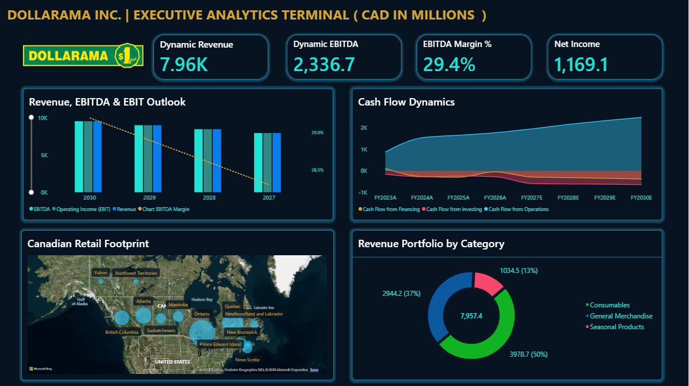
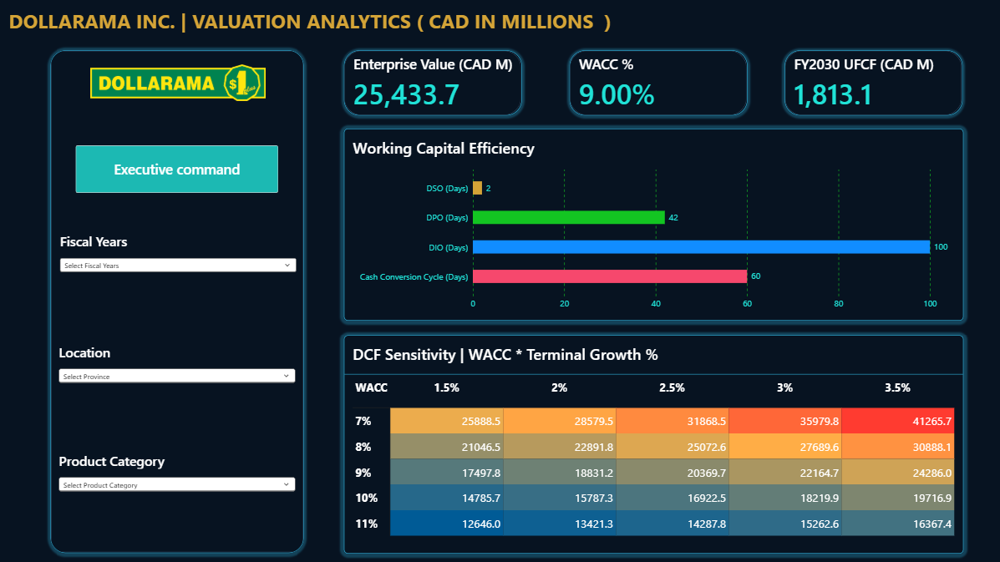

# Dollarama Inc. | Financial Planning & Analysis & Valuation

**Integrated Financial Modelling · Driver-Based Forecasting · Budget vs. Reforecast · Scenario Analysis · DCF Valuation · Power BI**

> Independent financial analysis of Dollarama Inc. combining historical performance, operating forecasts, management reporting and business valuation. Prepared as a professional financial analysis portfolio project.

---

## Executive Overview

This project develops an integrated financial planning and valuation model for Dollarama Inc., incorporating FY2023–FY2026 historical financial performance and FY2027–FY2030 projections.

The model connects store expansion, comparable-store sales, operating costs, capital expenditure and working capital to financial statements and free cash flow.

A two-page Power BI dashboard translates the model into interactive executive reporting, supporting profitability analysis, budget monitoring, scenario planning and valuation.

### Key Financial Highlights

*CAD millions unless otherwise indicated.*

| Financial Metric | Model Output |
|:---|---:|
| Historical Analysis | FY2023–FY2026 |
| Financial Forecast | FY2027–FY2030 |
| FY2027 Budget Revenue | $8,030.0M |
| FY2027 Reforecast Revenue | $7,957.4M |
| FY2027 Budget EBITDA | $2,336.7M |
| FY2027 Reforecast EBITDA | $2,252.0M |
| FY2027 Unlevered Free Cash Flow | $1,415.3M* |
| Weighted Average Cost of Capital | 9.0% |
| DCF Enterprise Value | $25,926.0M* |

---

## 1. Operating Drivers & Revenue Forecast

The revenue forecast is constructed using operational assumptions rather than applying a single consolidated growth rate.

**Key operating drivers:**
- Canadian store openings and closures
- Australian operating performance
- Consolidated revenue development

**Key insight:** Retail expansion and comparable-store sales performance represent distinct sources of growth. Separating these drivers improves visibility into the sustainability of revenue and the operational requirements of future expansion.

---

## 2. Integrated Three-Statement Financial Model

The financial model links operating assumptions to profitability, financial position and cash generation.

| Financial Statement | Analytical Focus |
|:---|:---|
| Income Statement | Revenue, COGS, SG&A, EBITDA, EBIT and net income |
| Balance Sheet | Assets, liabilities, working capital, debt and equity |
| Cash Flow Statement | Operating, investing and financing cash flows |

### Supporting Financial Schedules

**PP&E and Capital Expenditure**

A PP&E roll-forward connects opening asset balances, capital expenditure, depreciation and other adjustments to forecast asset balances.

**Working Capital**

DSO, DIO and DPO assumptions drive receivables, inventory and payables, providing a basis for cash conversion cycle analysis.

**Key insight:** Profitability growth must be evaluated alongside reinvestment requirements and working capital efficiency. Strong earnings do not automatically translate into equivalent cash flow generation.

### Income Statement

*Screenshot to be added.*

### Balance Sheet & Cash Flow

*Screenshot to be added.*

---

## 3. Budget vs. Reforecast & PVM Analysis

The FY2027 budget and reforecast are compared to identify deviations in expected financial performance.

### FY2027 Financial Variance

| Metric | Reforecast vs. Budget |
|:---|---:|
| Revenue | −0.9% |
| EBITDA | −3.6% |
| Net Income | −5.1% |

*Percentages are rounded illustrative model variances pending final workbook reconciliation.*

### Price-Volume-Mix Analysis

The PVM framework decomposes revenue movements into three components:

- **Price Effect:** Impact of changes in selling prices
- **Volume Effect:** Impact of changes in units sold
- **Mix Effect:** Impact of changes in product-category composition

The analysis uses illustrative product-category assumptions to examine household, food and seasonal merchandise performance.

### Management Interpretation

The reforecast indicates a relatively modest revenue shortfall but a more pronounced decline in EBITDA and net income.

This highlights the sensitivity of operating profitability to sales performance, merchandise margins and operating expenses.

**Management priority:** Monitor sales productivity, gross margin performance and SG&A efficiency while evaluating the effectiveness of store expansion.

### Budget vs. Reforecast, PVM & EBITDA Variance Bridge

*Screenshot to be added.*

---

## 4. Scenario Planning & Sensitivity Analysis

Three financial scenarios assess how changes in operating assumptions influence projected profitability.

| Scenario | Financial Assumptions | Expected Impact |
|:---|:---|:---|
| Best Case | Higher sales growth and stronger cost efficiency | Improved profitability |
| Base Case | Central operating forecast | Reference planning case |
| Worst Case | Slower growth and greater cost pressure | Reduced profitability |

The scenario model evaluates changes in revenue growth, COGS and SG&A assumptions across the forecast period.

Two-way sensitivity matrices examine the impact of changes in financial drivers on EBITDA and net income.

### Scenario Comparison

*Screenshot to be added.*

---

## 5. Discounted Cash Flow Valuation

The valuation model estimates enterprise value using projected unlevered free cash flow and a discounted cash flow methodology.

### Valuation Framework

| Component | Methodology |
|:---|:---|
| Cash Flow | Unlevered Free Cash Flow |
| Forecast Horizon | FY2027–FY2030 |
| Discount Rate | 9.0% WACC |
| Terminal Growth | 2.5% |
| Terminal Value | Perpetual Growth Method |
| Sensitivity | WACC vs. Terminal Growth |

### Free Cash Flow Development

Unlevered free cash flow is calculated.

Projected cash flows and terminal value are discounted to estimate enterprise value.

### Valuation Interpretation

The DCF highlights the importance of operating profitability, reinvestment requirements and long-term growth assumptions.

Terminal value represents a substantial proportion of the estimated enterprise value, making the valuation particularly sensitive to WACC and perpetual growth assumptions.

**Key insight:** Valuation should be assessed across a range of discount rates and terminal growth assumptions rather than relying exclusively on a single enterprise value estimate.

### DCF Valuation Model

*Screenshot to be added.*

### Enterprise Value Sensitivity

*Screenshot to be added.*

---

## 6. Power BI | Executive Financial Dashboard

The two-page interactive Power BI dashboard consolidates operating performance, financial planning and valuation into a management reporting environment.

### Page 1 — Executive Financial Performance

**Reporting coverage:**
- Revenue and EBITDA performance
- Operating profitability trends
- Historical vs. forecast financial performance
- Cash flow analysis shaded area chart
- Geographic retail footprint map
- Product-category revenue composition

Interactive visuals and reporting filters support financial performance comparisons across the model.

### Executive Analytics Dashboard

### Page 2 — Financial Planning & Valuation

**Reporting coverage:**
- Financial KPI cards
- Working Capital comparison bar chart 
- Enterprise value
- DCF sensitivity heat map

The dashboard integrates operating and valuation analysis to provide a consolidated view of business performance and financial planning outcomes.

### Planning & Valuation Dashboard

---

## Tools & Analytical Capabilities

| Platform | Application |
|:---|:---|
| Microsoft Excel | Three-statement modelling, forecasting and DCF |
| Power Query | Data preparation and transformation |
| Power BI | Interactive executive reporting |
| DAX | Financial measures and dynamic KPI analysis |
| Financial Analysis | Budget variance, PVM, scenarios and valuation |

---

## Project Files

**Excel Financial Model**

`Dollarama FP & A project.xlsx`

Integrated historical financial statements, operating forecasts, financial schedules, budget analysis, scenarios and DCF valuation.

**Power BI Report**

`FP&A Dashboard.pbix`

Two-page interactive financial reporting and valuation dashboard.

**Project Screenshots**

Selected Excel model and Power BI dashboard screenshots will be added to the corresponding sections.

---

## Data Sources & Disclaimer

Historical financial information is based on Dollarama's publicly available annual reports and management discussion and analysis.

Financial forecasts, operating assumptions, budget scenarios, PVM calculations and valuation estimates are independently developed for educational and portfolio purposes.

This project is not affiliated with or endorsed by Dollarama Inc. and does not constitute investment advice.
